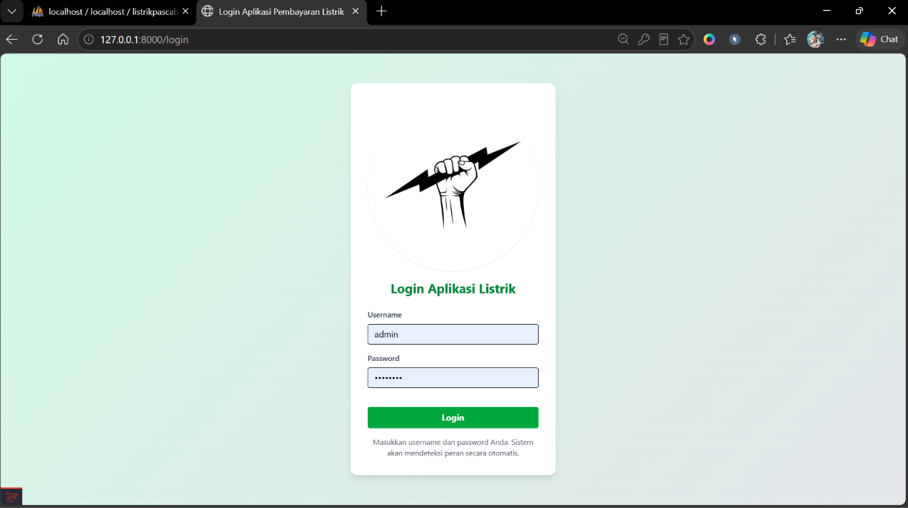
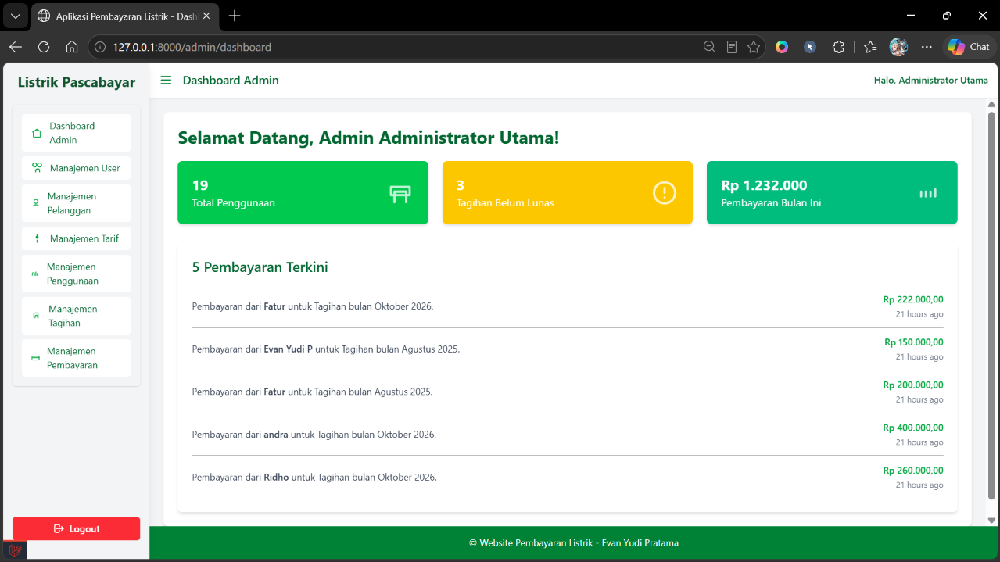

# Aplikasi Pembayaran Listrik Pascabayar

Aplikasi web berbasis **Laravel** untuk mengelola pembayaran listrik pascabayar: data pelanggan, tarif, pemakaian meter bulanan, tagihan, hingga pencatatan pembayaran. Aplikasi memiliki pembagian hak akses untuk **Administrator** dan **Petugas**.

Project ini dibuat sebagai tugas perkuliahan Program Studi Teknologi Informasi, Universitas Bina Sarana Informatika (Depok).

> **Catatan:** Aplikasi ini membutuhkan server PHP dan database, sehingga **tidak dapat dijalankan lewat GitHub Pages**. Ikuti langkah instalasi lokal di bawah, atau lihat bagian [Tampilan Aplikasi](#tampilan-aplikasi).

## Fitur

| Peran | Fitur |
| --- | --- |
| **Administrator** | Dashboard, kelola user, kelola pelanggan, kelola tarif, kelola data penggunaan (meter awal dan akhir), kelola tagihan (termasuk buat tagihan dari data penggunaan), kelola pembayaran |
| **Petugas** | Dashboard, melihat data pelanggan dan tarif, kelola data penggunaan, tagihan, dan pembayaran |
| **Pelanggan** | Dashboard, riwayat penggunaan, tagihan saya, bayar tagihan, riwayat pembayaran, profil *(masih dalam pengembangan, lihat bagian Catatan)* |

Fitur tambahan:
- Dokumentasi API dengan Swagger (`l5-swagger`) dan Scramble
- Endpoint API untuk dashboard dan tagihan (`routes/api.php`)

## Teknologi

| Komponen | Keterangan |
| --- | --- |
| Bahasa | PHP ^8.2 |
| Framework | Laravel ^12.0 |
| Database | MySQL (juga bisa memakai SQLite) |
| Frontend | Blade, Tailwind CSS 4, Vite |
| Dokumentasi API | `darkaonline/l5-swagger`, `dedoc/scramble` |

## Struktur Database

Tabel utama: `level`, `users`, `tarifs`, `pelanggan`, `penggunaan`, `tagihan`, `pembayaran`.

```
level ──< users
tarifs ──< pelanggan ──< penggunaan ──1:1── tagihan ──< pembayaran
```

## Kebutuhan Sistem

- PHP 8.2 atau lebih baru (disarankan memakai [XAMPP](https://www.apachefriends.org/) versi PHP 8.2+)
- [Composer](https://getcomposer.org/)
- [Node.js](https://nodejs.org/) dan npm
- MySQL (bawaan XAMPP) atau SQLite

## Instalasi Lokal

### 1. Clone repository dan install dependensi

```bash
git clone https://github.com/evnydprtma12/listrik-pascabayar
cd listrik-pascabayar

composer install
npm install
npm run build
```

### 2. Siapkan file environment

```bash
# Linux / macOS
cp .env.example .env

# Windows (Command Prompt)
copy .env.example .env

php artisan key:generate
```

### 3. Atur database

**Opsi A: MySQL (XAMPP)**

1. Jalankan Apache dan MySQL dari XAMPP.
2. Buka phpMyAdmin, lalu buat database baru bernama `listrikpascabayar`.
3. Ubah bagian database di file `.env`:

```env
DB_CONNECTION=mysql
DB_HOST=127.0.0.1
DB_PORT=3306
DB_DATABASE=listrikpascabayar
DB_USERNAME=root
DB_PASSWORD=
```

**Opsi B: SQLite (lebih cepat, tanpa MySQL)**

Biarkan `DB_CONNECTION=sqlite` di `.env`, lalu buat file database kosong:

```bash
# Linux / macOS
touch database/database.sqlite

# Windows (Command Prompt)
type nul > database\database.sqlite
```

### 4. Jalankan migrasi dan seeder

```bash
php artisan migrate --seed
```

Perintah ini membuat semua tabel dan dua akun awal (lihat [Akun Login](#akun-login)). Data tarif dan pelanggan contoh dapat ditambahkan dengan:

```bash
php artisan db:seed --class=TarifSeeder
php artisan db:seed --class=PelangganSeeder
```

> Jalankan `TarifSeeder` terlebih dahulu karena data pelanggan memerlukan tarif.

### 5. Jalankan aplikasi

```bash
php artisan serve
```

Buka **http://127.0.0.1:8000** di browser. Halaman utama otomatis mengarah ke halaman login.

## Akun Login

Akun berikut dibuat oleh seeder (untuk keperluan demonstrasi):

| Peran | Username | Password |
| --- | --- | --- |
| Administrator | `admin` | `password` |
| Petugas | `petugas` | `password` |

Ubah password tersebut jika aplikasi dipakai di luar keperluan demonstrasi.

## Dokumentasi API

Setelah aplikasi berjalan, dokumentasi Swagger dapat dibuka di:

```
http://127.0.0.1:8000/api/documentation
```

## Struktur Folder

```
├── app/
│   ├── Http/Controllers/     # Controller (Auth, Tarif, Pelanggan, Penggunaan, Tagihan, Pembayaran, User, Dashboard)
│   ├── Http/Middleware/      # AdminMiddleware, PetugasMiddleware
│   └── Models/               # Level, User, Tarif, Pelanggan, Penggunaan, Tagihan, Pembayaran
├── database/
│   ├── migrations/           # Struktur tabel
│   └── seeders/              # Data awal
├── resources/views/          # Tampilan Blade (admin, petugas, pelanggan, tagihan, pembayaran, dll.)
├── routes/
│   ├── web.php               # Route halaman web
│   └── api.php               # Route API
└── public/                   # Entry point aplikasi
```

## Tampilan Aplikasi






## Catatan

- Portal **pelanggan** belum selesai: route `pelanggan/*` memakai guard `auth:pelanggan` yang belum didefinisikan di `config/auth.php`, dan controller login pelanggan belum tersedia di project ini.
- File `.env`, folder `vendor/`, dan `node_modules/` tidak disertakan di repository. Buat ulang dengan langkah instalasi di atas.

## Kontak

- **Nama:** [Evan Yudi Pratama]
- **Email:** [evanyudipratama12@gmail.com]